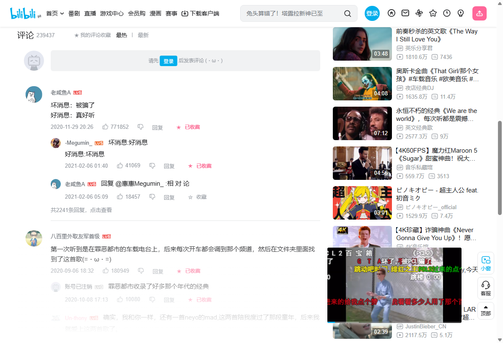
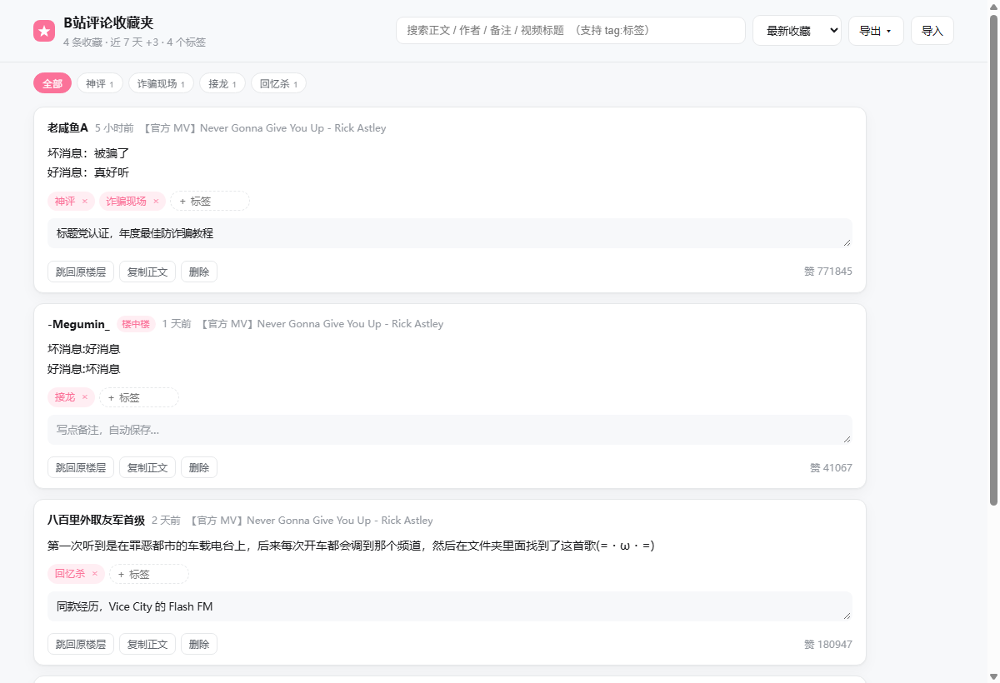

# B站评论收藏夹 · Bilibili Comment Collector

给 B 站评论区加一个「☆ 收藏」按钮：**一条神评，点一下就存下来**，之后能搜、能打标签、能跳回原楼层，还能导出成 Markdown / JSON / CSV。

不登录、不联网、不调 B 站接口 —— 只读页面已经渲染出来的评论，数据全部存在浏览器本地。
**Chrome / Edge / Firefox 通用**（同一份代码，manifest 同时声明了两套 background 入口）。






## 为什么做这个

B 站自带的「收藏」只能收藏视频，看到一条好评论，只能截图或者复制到记事本 —— 复制完就不知道它出自哪个视频、哪一层楼了。

现有的方案要么是整页批量抓评论导出 CSV（那是数据采集，不是日常收藏），要么带云端 AI 分析、要把评论内容上传走。这个扩展只做一件事：**把你在页面上看到的这条评论，连同它的出身（视频、作者、楼层）一起留在本地。**

## 功能

- **一键收藏评论，含楼中楼**：评论操作栏末尾多一个「☆ 收藏」，点击即存；已收藏显示「★ 已收藏」
- **跳回原楼层**：用 B 站自己的深链格式，打开后自动滚到那条评论并描边高亮
- **搜索**：正文 / 作者 / 备注 / 视频标题全文匹配，支持 `tag:标签`、`#标签` 过滤
- **标签与备注**：给收藏分类、写自己的批注，备注停手自动保存
- **导出 / 导入**：Markdown（按视频分组、引用块正文）、JSON（可再导入）、CSV（带 BOM，Excel 直接开）
- **全部本地**：只申请 `storage` 与 `unlimitedStorage`，没有 `tabs`、没有 `cookies`、没有任何网络请求

## 安装

### Chrome / Edge

1. 到 [Releases](../../releases) 下载最新的 `bilibili-comment-collector-x.y.z.zip`
2. 解压到任意固定目录（**不要放在临时目录，删了就没了**）
3. 打开 `chrome://extensions`（Edge 是 `edge://extensions`），打开右上角**开发者模式**
4. 点**加载已解压的扩展程序**，选择解压出来的文件夹
5. 打开任意 B 站视频页，鼠标移到评论上，操作栏末尾点「☆ 收藏」

> 需要 Chrome / Edge 121 或更高版本（用到了 `world: "MAIN"` 的 content script；
> 为了兼容 Firefox，manifest 里同时写了 `background.scripts`，而 Chrome 121 之前会因此拒绝加载）。
> 首次安装后如果评论按钮没出现，刷新一下页面。

### Firefox

Firefox 不能直接加载 zip，需要解压后用临时附加组件加载：

1. 同样下载并解压发布包
2. 地址栏打开 `about:debugging#/runtime/this-firefox`
3. 点**临时载入附加组件…**，选中解压目录里的 `manifest.json`
4. 打开 B 站视频页即可

> - **重启浏览器后临时组件会消失**，需要重新载入。想长期使用得起个名字签名：上架
>   [AMO](https://addons.mozilla.org/developers/)（可以是 unlisted 自用），审核通过后拿到 `.xpi` 就能正常安装。
> - 未签名的 `.xpi` 在正式版 Firefox 里装不上，这是 Mozilla 的强制策略，不是扩展的问题。
> - 需要 Firefox 128 或更高版本。

### 从源码加载

```bash
git clone https://github.com/wudidadaqiuqiu/bilibili-comment-collector.git
```

Chrome：`chrome://extensions` →「加载已解压的扩展程序」→ 选仓库根目录。
Firefox：`about:debugging` →「临时载入附加组件」→ 选仓库根目录的 `manifest.json`。

## 用法

| 位置 | 作用 |
|---|---|
| 评论操作栏 | 点 **☆ 收藏** 存下这条评论；已收藏的显示 **★ 已收藏** |
| 评论区标题旁 | 点 **★ 我的评论收藏** 打开收藏夹 |
| 工具栏图标 | 看条数、最近 6 条，点一条直接跳回原楼层 |
| 收藏夹页面 | 搜索、标签、备注、跳转、复制、删除、导出 / 导入 |

**搜索语法**：默认全文匹配，多个词用空格分隔（AND 关系）。`tag:神评` 或 `#神评` 按标签过滤。

**导出**：右上角「导出 ▾」，导出的就是*当前筛选结果*（所见即所得）。

## 数据在哪、怎么备份

- 位置：`chrome.storage.local`，键名 `bshc:items:v1`
- **卸载扩展会连同数据一起删除**，重要的收藏请定期「导出 JSON」；换电脑用「导入」还原
- 想清空重来：`chrome://extensions` 移除扩展，或逐条删除

隐私：扩展不读取账号信息，不发起任何网络请求，不做任何上报。

## 它是怎么工作的

B 站现在的评论区是 Web Component + Shadow DOM，不是普通 HTML：

```
bili-comments                     ← document.querySelector('bili-comments')
└── #shadow-root
    ├── div#header > bili-comments-header-renderer
    └── div#contents > div#feed
        └── bili-comment-thread-renderer        ← 每个一级评论线程
            └── #shadow-root
                ├── bili-comment-renderer       ← 主评论，.data 是原始评论对象
                │   └── #shadow-root
                │       └── div#body > div#content
                │           ├── bili-rich-text        （正文）
                │           └── bili-comment-action-buttons-renderer
                │               └── #shadow-root > #pubdate #like #dislike #reply #more
                └── bili-comment-replies-renderer   ← 楼中楼容器
                    └── #shadow-root > bili-comment-reply-renderer（同样有 .data）
```

两个关键点：

**1. 为什么是两个 content script**（`src/content/bridge.js` + `src/content/content.js`）

`bili-comment-renderer.data` 是页面 JS 上下文里的对象属性，普通 content script 跑在隔离世界，读不到。所以：

- `bridge.js` 声明 `"world": "MAIN"`，与页面共享 JS 上下文，负责读 `.data`；它把需要的一小撮字段（rpid / oid / root / parent / ctime / like / 正文 / 作者）序列化后写到元素的 `data-bshc` 属性上 —— **attribute 是两个世界共享的**
- `content.js` 在隔离世界，读 `data-bshc`、注入按钮、和 background 通信

这样隔离世界始终有 `chrome.runtime` 可用，又不需要用 `postMessage` 传递 DOM 引用。

Firefox 128+ 同样支持 `world: "MAIN"`，所以两个浏览器走同一条路径。另外 `bridge.js` 还留了一层兜底：
若某个版本不认 `world`，脚本退回隔离世界后 `el.data` 读不到，会改用 `el.wrappedJSObject.data`
透过 Xray 读页面对象 —— 功能仍然是好的。

**2. 跳到指定楼层**

B 站前端代码里有 `var Fm = /^#reply(\d+)$/`：hash 命中时把 rpid 作为 `seekId` 传给评论组件，并关闭懒加载。这就是官方「复制评论链接」背后的机制，扩展直接复用，不用自己翻页查找。

**样式**：按钮注入在 shadow root 里，页面 CSS 进不来。用 `CSSStyleSheet` + `adoptedStyleSheets` 把一份样式表挂到所有相关 shadow root（不可用时退回 `<style>` 标签）。

**并发**：所有写操作都经过 background 的串行队列，多标签页同时收藏不会互相覆盖。

**跨浏览器**：Chrome 的 MV3 只认 `background.service_worker`，Firefox 只认 `background.scripts`，
所以 manifest 里两个都写（[MDN 推荐写法](https://developer.mozilla.org/en-US/docs/Mozilla/Add-ons/WebExtensions/manifest.json/background#cross-browser_manifest_v3_background_scripts)），
各自忽略对方那个键。存储读写统一走 `src/shared/browser.js`，因为 Firefox 的 `chrome.*`
在部分版本没有 Promise —— 直接 `await chrome.storage.local.get()` 会拿到 `undefined` 而静默失败。

## 目录结构

```
bilibili-comment-collector/
├── manifest.json
├── src/
│   ├── background.js          Service Worker：唯一写入方、串行队列、角标
│   ├── shared/model.js        数据规范化、搜索、导出（纯函数）
│   ├── shared/browser.js      storage 的 Promise/回调双兼容包装（Firefox 老版本只有回调）
│   ├── content/
│   │   ├── bridge.js          MAIN world：把 .data 写成 data-bshc
│   │   ├── content.js         隔离世界：注入按钮、收藏、深链高亮
│   │   └── content.css        页面级 toast 样式
│   ├── popup/                 工具栏弹窗
│   ├── manager/               收藏夹页面
│   └── icons/
├── scripts/check.mjs          自检：manifest、文件引用、JS 语法、图标尺寸
└── .github/workflows/         check（推送/PR）+ release（打 tag 自动发版）
```

## 开发

```bash
npm run check     # 等价于 CI 跑的自检，无需安装依赖
npm run build     # 打包到 dist/，产出 .zip 与 Firefox 用的 .xpi
```

自检除了 manifest 引用、JS 语法、图标尺寸，还会校验**双浏览器**的关键点：
`background.scripts` 与 `service_worker` 是否都声明、`minimum_chrome_version` 是否 ≥121、
`browser_specific_settings.gecko.id` 是否存在、是否还有 `world: "MAIN"` 的 content script。

改完代码在 `chrome://extensions` 点该扩展的刷新按钮即可，**然后在已打开的 B 站页面刷新一次**（content script 不会热更新）。

打包产物（`dist/`）：

| 文件 | 用途 |
|---|---|
| `bilibili-comment-collector-<ver>.zip` | Chrome / Edge 加载已解压 |
| `bilibili-comment-collector-<ver>-firefox.xpi` | 上传 AMO 签名；相对通用包剥掉了 `background.service_worker` 与 `minimum_chrome_version` 两个 Chrome 专用字段，避免 AMO 校验器报警 |

发布：

```bash
# 1. 先改 manifest.json 和 package.json 的版本号并提交
# 2. 打 tag 推送，Release 由 workflow 自动创建，两个包都会挂上去
git tag v1.1.0 && git push origin v1.1.0
```

上架 AMO 的流程：`npm run build` → 到 [AMO 开发者中心](https://addons.mozilla.org/developers/addon/submit/distribution)
上传 `dist/*-firefox.xpi` → 选自用分发（On your own）→ 等自动校验通过 → 下载签名好的 `.xpi` 安装。
签名后的 `.xpi` 会保留 `browser_specific_settings.gecko.id`，所以每次更新都算同一个扩展的升级。

## 已知边界

- **只收藏页面已经渲染出来的评论**。不调接口、不自动翻页，所以「共 2241 条回复」里没展开的部分收藏不到；楼中楼默认展开的前 2 条可以直接收藏，展开更多后也能收
- 极少数页面（如部分专题页）评论组件结构不同，按钮不会出现
- 页面结构若大改导致按钮消失，改这两个函数即可：`src/content/bridge.js` 的 `collect()`、`src/content/content.js` 的 `collect()`
- 收藏时记下的是那一刻的点赞数，之后不会更新
- **Firefox 上组件重渲染后可能丢按钮**：评论列表刷新时 B 站会替换节点，扩展 0.9 秒轮询一次自动补回来，正常看不到闪烁
- **Firefox 重启后扩展消失**：临时附加组件的固有行为，需要签名安装才能长期使用（见「安装」）
- 两个浏览器的收藏数据各自独立（各存各的 `storage.local`），不能互通；用「导出 JSON / 导入」迁移

## 排错

页面控制台执行：

```js
__BSHC_DUMP__()   // 桥接层当前抓到的评论数组
```

- 返回数组但没有按钮 → `content.js` 没跑起来，检查扩展是否启用、页面是否已刷新
- `__BSHC_DUMP__ is not defined` → `bridge.js` 没注入，确认 Chrome ≥ 111
- 点收藏提示「后台没有响应」→ Service Worker 被回收或扩展刚更新，刷新页面
- 收藏夹页面空白 → 打开 `chrome://extensions` 看该扩展有无红色报错
- **Firefox 里按钮不出现**：确认版本 ≥ 128；再看 `about:debugging` 里扩展是否还挂着（重启后需要重新载入），
  以及是否在 `about:debugging` 的「检查」里能看到 console 报错

## 免责声明

本项目与哔哩哔哩（bilibili）官方无关，是个人使用的第三方工具。仅用于保存你自己看到的公开评论，请遵守 B 站用户协议，不要用于批量抓取或商业用途。

## License

[MIT](LICENSE)
